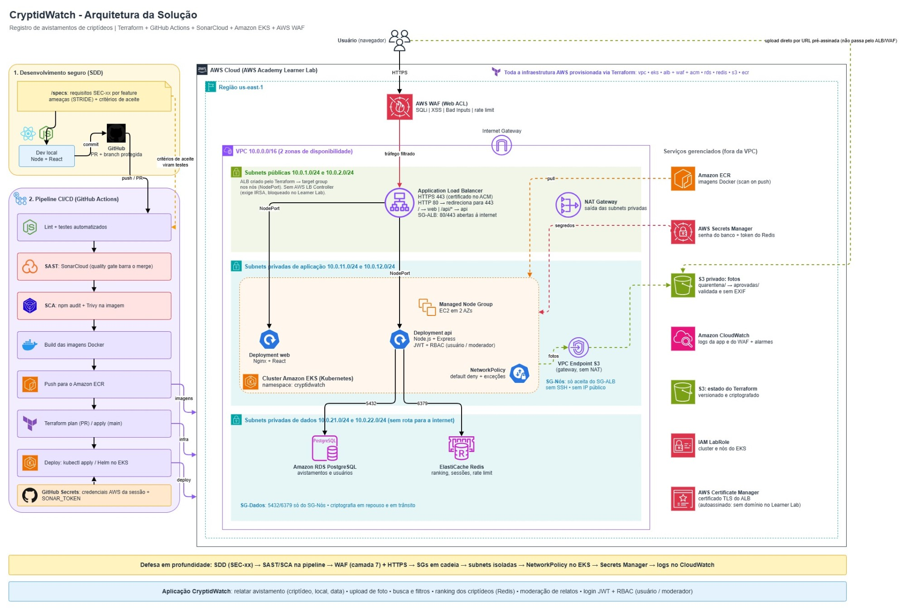

# CryptidWatch

Registro de avistamentos de criptídeos — trabalho final de Auditoria e Segurança de Sistemas (UNIDAVI).

## Estrutura

| Pasta | Conteúdo |
|---|---|
| `specs/` | Especificações de segurança (SDD): requisitos SEC-xx, ameaças STRIDE, critérios de aceite |
| `app/api/` | API Node.js + Express (JWT + RBAC, PostgreSQL, Redis, S3) |
| `app/web/` | Frontend React servido por Nginx |
| `k8s/` | Manifests Kubernetes (namespace, deployments, services NodePort, NetworkPolicy) |
| `infra/terraform/` | Infraestrutura AWS (VPC, EKS, ALB + WAF + ACM, RDS, ElastiCache, S3, ECR) |
| `.github/workflows/` | Pipeline CI/CD (lint, testes, SonarCloud, npm audit, Trivy, build, deploy) |
| `docs/` | Diagrama e evidências |

## Defesa em profundidade

SDD (SEC-xx) → SAST/SCA na pipeline → WAF (camada 7) + HTTPS → SGs em cadeia →
subnets isoladas → NetworkPolicy no EKS → Secrets Manager → logs no CloudWatch.

> ⚠️ Ambiente AWS Academy Learner Lab: rode `terraform destroy` ao terminar de testar.
